# 🚀 WebAPI-Complete-Mastery (.NET 10)

[](https://dotnet.microsoft.com/)
[](https://docs.microsoft.com/en-us/dotnet/csharp/)
[](https://learn.microsoft.com/aspnet/core)
[](LICENSE)

> **Найповніший практичний посібник та виробничий лабораторний стенд з розробки Web API та бекенд-сервісів на .NET 10.**  
> Охоплює повний спектр знань: від фундаментальних механік Inversion of Control та Minimal APIs до високонавантаженого кешування, зворотних проксі (YARP), NoSQL (MongoDB), моніторингу (OpenTelemetry) та інтеграційного тестування.

---

## 🏛️ Архітектурна карта курсу

```mermaid
flowchart TD
    Client["🌐 Клієнт (SPA / Mobile / Desktop / curl)"]
    
    subgraph GatewayLayer ["🚪 Рівень шлюзів та зворотного проксі"]
        Yarp["Microsoft YARP (Модуль 10)"]
        Ocelot["Ocelot API Gateway (Модуль 10)"]
    end
    
    subgraph CoreServices ["⚡ Сервіси Web API (.NET 10)"]
        DI["01. DI & IoC Контейнери
(Transient / Scoped / Singleton)"]
        API["02. Minimal APIs & Controllers
Scalar UI / OpenAPI"]
        Middleware["03. Middleware & Валідація
FluentValidation / ProblemDetails"]
        Mapping["04. Мапінг та Сідінг
AutoMapper & Bogus Data"]
        Patterns["05. Патерни та Запити
Specification / HATEOAS / Expressions"]
    end
    
    subgraph InfraLayer ["💾 Інфраструктура та Сховища"]
        Cache[("06. Кешування
InMemory / Distributed Redis")]
        Files["08. Файлове сховище
Streaming / Multipart"]
        Mongo[("09. NoSQL База даних
MongoDB Aggregations / Transactions")]
    end
    
    subgraph ObservabilityLayer ["📊 Моніторинг та Тестування"]
        Telemetry["07. Логування та Трасування
Serilog & OpenTelemetry"]
        Tests["11. Автоматизоване тестування
xUnit / Moq / WebApplicationFactory"]
    end

    Client --> GatewayLayer
    GatewayLayer --> API
    API --> DI
    API --> Middleware
    API --> Patterns
    Patterns --> Mapping
    API --> Cache
    API --> Files
    API --> Mongo
    API --> Telemetry
    Tests -.->|Перевіряє роботу| API
```



---

## 📚 Зміст та модулі курсу

| Модуль | Назва та напрямок | Ключові технології та концепції |
| :---: | :--- | :--- |
| **01** | **[Dependency Injection & IoC](01-Dependency-Injection-And-IoC)** | Dependency Inversion Principle, Factory Pattern, Service Lifetimes, Generic Host, IoC Containers |
| **02** | **[WebAPI Core, Minimal APIs & Scalar](02-WebAPI-Core-MinimalApis-And-Scalar)** | Minimal APIs, Endpoint Filters, Scalar UI (Next-gen Swagger), Options Pattern (`IOptionsSnapshot`, `IOptionsMonitor`) |
| **03** | **[Validation & Error Handling](03-Validation-Middleware-And-ErrorHandling)** | FluentValidation, ModelState, MediatR IPipelineBehavior, ProblemDetails RFC 7807, Global Exception Middleware |
| **04** | **[Data Mapping & Seeding](04-Data-Mapping-And-Seeding)** | AutoMapper (DTO Projections), Bogus (генерація мільйонів тестових записів), Web Scraping |
| **05** | **[Advanced Querying & Patterns](05-Advanced-Querying-And-Patterns)** | Specification Pattern, Paging, Filtering, Sorting, Data Shaping, HATEOAS, динамічні Expression Trees |
| **06** | **[Caching & Performance](06-Caching-And-Performance)** | In-Memory Cache (`IMemoryCache`), Розподілений кеш Redis (`IDistributedCache`), Cache-Aside патерн |
| **07** | **[Logging & Observability](07-Logging-And-Observability)** | Структуроване логування Serilog (Sinks, Enriched Logs), розподілене трасування та метрики OpenTelemetry |
| **08** | **[File Handling & Streaming](08-File-Handling-And-Streaming)** | Потокове завантаження великих файлів (Streaming multipart), Swagger upload, збереження в БД |
| **09** | **[NoSQL & MongoDB Integration](09-NoSQL-MongoDB-Integration)** | MongoDB .NET Driver, типізовані Bson-моделі, агрегаційні конвеєри ($lookup, $match), розподілені транзакції |
| **10** | **[Gateways & Reverse Proxy](10-Gateways-And-Reverse-Proxy)** | Microsoft YARP (Yet Another Reverse Proxy), Ocelot Gateway, маршрутизація мікросервісів, gRPC Aggregator |
| **11** | **[Unit & Integration Testing](11-Unit-And-Integration-Testing)** | Модульні тести на xUnit, Mocking через Moq, повноцінні наскрізні тести Web API з `WebApplicationFactory` |

---

## ⚡ Швидкий старт

### Вимоги:
- **.NET SDK 10.0** або новіший (`dotnet --version`)
- **Docker Desktop** (для підняття Redis, MongoDB та Jaeger за потреби)

### Клонування та збірка:
```bash
git clone https://github.com/MrTomkaYurii/WebAPI-Complete-Mastery.git
cd WebAPI-Complete-Mastery

# Зібрати всі модулі курсу:
dotnet build
```

---

## 👨‍💻 Авторство та ліцензія
- **Автор:** [MrTomkaYurii](https://github.com/MrTomkaYurii)
- **Ліцензія:** MIT
